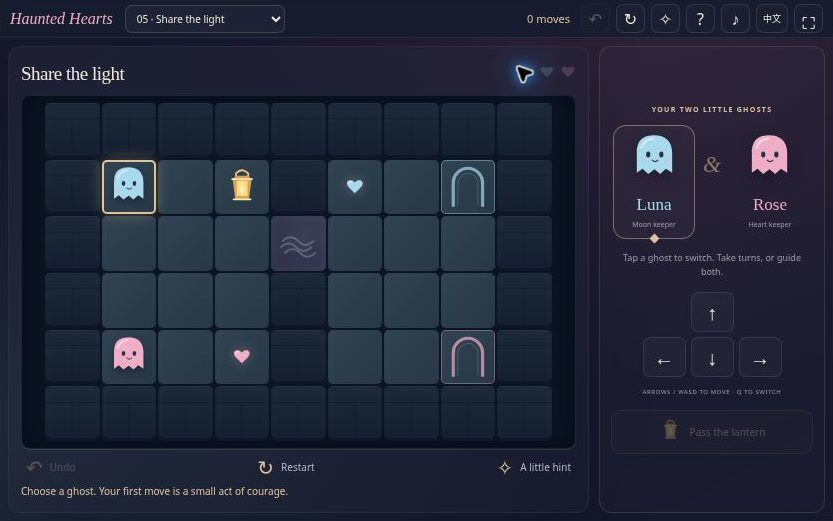
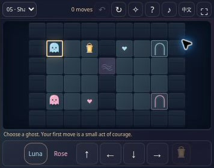

[English](README.md) · [简体中文](README.zh-CN.md) · [Español](README.es.md) · [Português (Brasil)](README.pt-BR.md) · [日本語](README.ja.md)

# Haunted Hearts — Halloween Co-op Puzzle Game

👻 Two little ghosts, two half-hearts, and one lantern to share. Guide Luna and Rose through eight haunted rooms where a helpful partner can open the way home. Play this gentle Halloween logic game alone by switching characters, or share one device and plan the next move together.

**[Play online](https://halloween-love-game.crazy3d.org/)** · [Explore all 12 Halloween games](https://github.com/AshinTop/halloween-games) · [⭐ Star this repository](https://github.com/AshinTop/halloween-love-game)

README translations cover five languages. The **game interface currently supports English and Simplified Chinese only**.



## What makes it special

- Eight single-screen rooms introduce gates, personal paths, and lantern sharing in small steps.
- Two independently controlled ghosts have their own heart halves and home arches.
- Unlimited undo, restart, and a solver-backed next-step hint leave room to experiment.
- Best move records and room links give completed puzzles a reason to revisit.
- Original SVG scenery, optional synthesized sound, touch and keyboard controls, and reduced-motion support.

## How to play

Select Luna or Rose, collect each ghost’s own half-heart, then finish with both ghosts on their matching arches. Luna uses blue moon tiles and collects the blue heart; Rose uses pink rose tiles and collects the pink heart. They cannot occupy the same square.

Moon and star pressure plates hold their matching gates open **while occupied**. Before leaving a plate, check whether the partner still needs the door. A second plate can let one ghost take over the job.

The shared lantern allows its carrier to **enter mist**. Pass it when the ghosts stand next to each other. A ghost already in mist may leave after giving the lantern away, which makes some crossings possible.

The eight rooms progress from a simple reunion to combined door-and-lantern puzzles. There is no timer or move limit. Their verified shortest starting routes use **8, 18, 22, 20, 19, 24, 28, and 30 moves**; these are replay goals, not completion requirements.

## Controls

| Action | Input |
| --- | --- |
| Choose a ghost | Click its portrait or character; **Q** switches |
| Move | Arrow keys / **WASD**, direction buttons, or an adjacent tile |
| Pass the lantern | **L** or **Pass the lantern**, while adjacent |
| Undo | **Z** or **Undo** |
| Hint / restart / room selection | The corresponding in-game buttons |

## A little strategy

Plan the helper’s position before sending a ghost through a gate. Leave a square for the partner to stand beside the lantern carrier. A hint selects the relevant ghost and describes the next action on a shortest route from the **current** position; you still perform it yourself. If the position has no solution, undo a few moves or restart.

## Progress and challenge links

Completed-room best move counts, language, and sound preferences stay in the current browser. Reloading restarts the selected room; unfinished individual moves are not resumed. Records do not synchronize across devices.

A link such as [room 6](https://halloween-love-game.crazy3d.org/#room=6) starts that room from the beginning. Sharing copies your actual completion result and a room link, without uploading a replay. If the clipboard is unavailable, the text appears for manual copying.

## Screenshots and video



Actual game screenshot from a compact browser iframe; this demonstrates the small-window layout, not a physical-phone test.

[Video player and transcript](https://halloween-love-game.crazy3d.org/intro.html) · [Download the MP4](docs/media/intro.mp4)

The **24-second silent introduction** combines actual screenshots and captions. It is a visual tour, not continuous gameplay footage or an audio demonstration.

## Frequently asked questions

### Do I need another player?

No. Switch between both ghosts to solve every room solo. Two people may share a device and take turns; remote multiplayer is not included.

### Why did the door close or the mist block me?

Doors require an occupied matching plate. Mist requires the lantern when entering a tile. Check both conditions before moving the helper.

### Is this a love calculator?

It is a cooperative puzzle with a heart-and-ghost theme. It does not request names, measure compatibility, or score relationships.

## Run locally and embed

Serve the repository root over HTTP:

```sh
python3 -m http.server 4173
```

Open **http://localhost:4173/**. No build or dependencies are needed. Use HTTP: `file://` can block JavaScript modules.

Run the included Node checks:

```sh
npm test
```

The tests cover complete routes through all eight rooms, collisions, personal tiles, pressure gates, lantern passing, mist entry, and invalid room links.

```html
<iframe src="https://halloween-love-game.crazy3d.org/?embed=1"
  title="Haunted Hearts"
  style="display:block;width:100%;height:521px;border:0"
  allow="fullscreen" allowfullscreen></iframe>
```

The main host stage is about **833×521** on desktop. Compact browser checks also covered **356×280**, **326×280**, **390×650**, and **844×340**. In very short frames, use the persistent direction buttons; a phone stage of **480 px or taller** is more comfortable when available. An iframe enables the compact layout automatically; `?embed=0` restores the full-page presentation.

See [EMBEDDING.md](EMBEDDING.md) for sizing, storage, input focus, and permissions. Measure available iframe height after the host toolbar.

## More little Halloween adventures

- **[Moonlit Mirrors](https://halloween-mirror-hearts.crazy3d.org/)** · [Source](https://github.com/AshinTop/halloween-mirror-hearts) — Guide two ghosts together through reflected puzzle boards.
- **[Ghost Lanterns 3D](https://halloween-3d.crazy3d.org/)** · [Source](https://github.com/AshinTop/halloween-3d) — Light a pumpkin garden with classic Lights Out logic and soul links.
- **[Witch’s Candy Blocks](https://halloween-block-blast.crazy3d.org/)** · [Source](https://github.com/AshinTop/halloween-block-blast) — Fit candy shapes into an 8×8 board and complete potion orders.
- **[Pumpkin Jam](https://halloween-sprunki.crazy3d.org/)** · [Source](https://github.com/AshinTop/halloween-sprunki) — Build an original four-part monster band and try Ghost Echo.

## Credits and support

Created for **AshinTop** and **Midnight Candy Club** with human-directed, AI-assisted design, programming, and review. Artwork and synthesized sounds are original to this project. The game needs no remote account; hosting may independently add scripts or request logs.

Enjoyed playing? **[Leave a GitHub Star](https://github.com/AshinTop/halloween-love-game)**. For bug reports, include browser, iframe size, challenge link, and reproduction steps.
